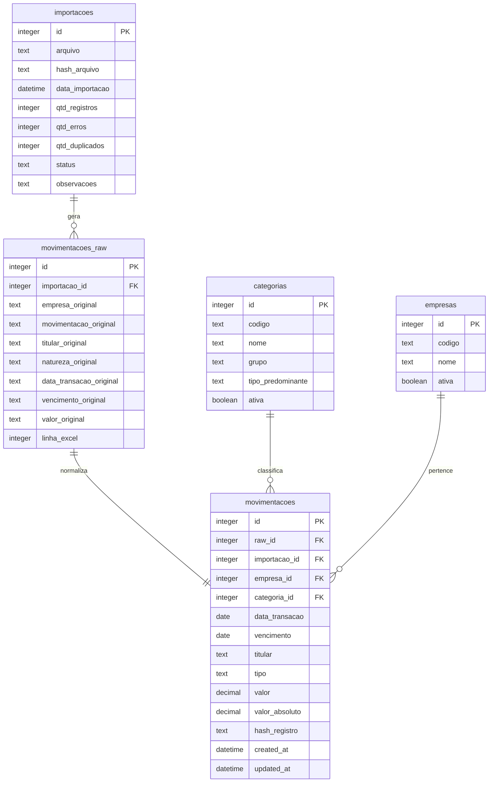

# FASE 1 — DESCOBERTA: Sistema de Gestão e Análise Financeira

## Resumo Executivo

Análise completa dos 3 arquivos do projeto: `FLUXODECAIXA.xlsx` (80.129 registros), `contasapagar.csv` (32.056 registros, 80 colunas) e `contasareceber.csv` (48.073 registros, 14 colunas). Abrange ~6,5 anos de dados financeiros (fev/2020 a ago/2026), 4 empresas, 215 categorias contábeis e R$ 120,7 milhões em movimentações.

---

## A. Estrutura Encontrada

### Arquivo Principal: `FLUXODECAIXA.xlsx`

| Coluna | Tipo (pandas) | Preenchimento | Observações |
|:---|:---|:---|:---|
| **Empresa** | `object` | 100% (80.129) | 4 valores: `NPD`, `COMPRE`, `DEMO`, `CS` |
| **Movimentação** | `object` | 100% (80.129) | 2 valores: `PAGAR` (32.056), `RECEBER` (48.073) |
| **Titular** | `object` | ~100% (80.128) | 6.324 titulares únicos. 1 nulo |
| **Natureza Contábil** | `object` | 100% (80.129) | 215 categorias únicas |
| **Data da Transação** | `datetime64` | 93,75% (75.118) | **5.011 datas ausentes** (registros não pagos) |
| **Vencimento** | `object` | ~100% (80.116) | 13 nulos. Contém datas anômalas |
| **Valor** | `float64` | 100% (80.129) | Todos positivos. 5.014 zeros |

### Distribuição por Empresa

| Empresa | PAGAR | RECEBER | Total | % |
|:---|---:|---:|---:|---:|
| **COMPRE** | 11.819 | 22.665 | 34.484 | 43,0% |
| **NPD** | 10.801 | 13.955 | 24.756 | 30,9% |
| **CS** | 5.580 | 10.229 | 15.809 | 19,7% |
| **DEMO** | 3.856 | 1.224 | 5.080 | 6,3% |

### Volumes Financeiros

| Tipo | Registros | Soma | Média | Mediana | Máximo |
|:---|---:|---:|---:|---:|---:|
| **PAGAR** | 32.056 | R$ 61.893.867,80 | R$ 1.930,80 | R$ 432,51 | R$ 167.875,65 |
| **RECEBER** | 48.073 | R$ 58.799.919,99 | R$ 1.223,14 | R$ 799,11 | R$ 48.246,24 |
| **TOTAL** | 80.129 | R$ 120.693.787,79 | R$ 1.506,24 | R$ 687,89 | — |

### Distribuição de Valores

| Faixa | Registros |
|:---|---:|
| == R$ 0,00 | 5.014 |
| R$ 0,01 — R$ 100,00 | 7.858 |
| R$ 100,01 — R$ 1.000,00 | 36.998 |
| R$ 1.000,01 — R$ 10.000,00 | 28.598 |
| R$ 10.000,01 — R$ 100.000,00 | 1.649 |
| > R$ 100.000,00 | 12 |

### Natureza Contábil — Top 10

| # | Categoria | Qtd | Tipo predominante |
|:---|:---|---:|:---|
| 1 | VENDA DE PRODUTOS | 47.602 | RECEBER |
| 2 | FR - FRETES VENDAS | 3.328 | PAGAR |
| 3 | DF - TARIFAS DE COBRANCA | 1.481 | PAGAR |
| 4 | TERC - COLAGEM DE ALCAS | 1.443 | PAGAR |
| 5 | IMP - ICMS | 1.235 | PAGAR |
| 6 | COM - COMISSOES VENDEDORES | 1.031 | PAGAR |
| 7 | DC - MARKETING E PROPAGANDA | 953 | PAGAR |
| 8 | CLI - CLICHES | 930 | PAGAR |
| 9 | DF - TARIFAS BANCARIAS | 751 | PAGAR |
| 10 | FUN - SALARIOS SOS | 687 | PAGAR |

### Padrão de Prefixos nas Categorias

As categorias seguem um padrão `PREFIXO - DESCRIÇÃO` que funciona como agrupador natural:

| Prefixo | Significado | Exemplos |
|:---|:---|:---|
| FR | Fretes | FR - FRETES VENDAS, FR - FRETES FORNECEDOR |
| DF | Despesas Financeiras | DF - TARIFAS BANCARIAS, DF - TAXA CARTAO |
| IMP | Impostos | IMP - ICMS, IMP - SIMPLES |
| COM | Comercial | COM - COMISSOES VENDEDORES |
| DC | Despesas Comerciais | DC - MARKETING E PROPAGANDA |
| CLI | Clichês | CLI - CLICHES |
| FUN | Funcionários | FUN - SALARIOS SOS, FUN - FGTS |
| MP | Matéria-Prima | MP - PAPEIS, MP - TINTA |
| ST | Serviços de Terceiros | ST - SOFTWARES, ST - HONORARIOS |
| RET | Retiradas | RET - PRO-LABORES |
| DG | Despesas Gerais | DG - TELEFONIA, DG - DIVERSOS |
| EST | Estoque/Devoluções | EST - DEVOLUCAO VALORES |
| EMP | Empréstimos | EMP - EMPRESTIMO |
| INV | Investimentos | INV - CONSORCIO BB |
| TERC | Terceirização | TERC - COLAGEM DE ALCAS |

### Fontes Originais (CSVs)

| Arquivo | Registros | Colunas | Destaque |
|:---|---:|---:|:---|
| `contasapagar.csv` | 32.056 | 80 | Rica em dados extras (CNPJ, Nota, Banco, Situacao, etc.) |
| `contasareceber.csv` | 48.073 | 14 | 99% é "VENDA DE PRODUTOS" |

---

## B. Problemas Encontrados

> [!CAUTION]
> ### Problema Crítico #1: Sinal dos Valores
> **Todos os 80.129 valores são positivos (≥ 0).** Porém, a Minuta de referência define que saídas (PAGAR) devem ter **valor negativo**. O sistema de importação original **não inverte o sinal**. Isso precisa ser tratado na normalização: o campo `Movimentação` determina o sinal (`PAGAR` → negativo, `RECEBER` → positivo).

> [!WARNING]
> ### Problema #2: Registros Sem Data de Pagamento (5.011 registros)
> - 3.545 registros de "contas a pagar" sem `Data Pagto.`
> - 1.466 registros de "contas a receber" sem `Pagamento`
> - Todos possuem `Valor = 0` — indicam **títulos em aberto / não pagos**
> - **Decisão necessária**: Incluir ou excluir do fluxo de caixa realizado?

> [!WARNING]
> ### Problema #3: Datas Anômalas no Vencimento
> - **1899-12-29**: Artefato do epoch do Excel (data "zero"). 1 registro.
> - **2054-02-25**: Data futura muito distante. Provável erro de digitação.
> - 13 vencimentos nulos.

> [!WARNING]
> ### Problema #4: Duplicidades
> - **675 linhas são duplicatas exatas** (todos os 7 campos idênticos)
> - **5.528 linhas** compartilham a mesma combinação (`Data da Transação` + `Titular` + `Valor`)
> - Podem ser legítimas (múltiplos pagamentos ao mesmo fornecedor no mesmo valor) ou erros

### Outros Problemas Identificados

| # | Problema | Impacto | Qtd |
|:---|:---|:---|---:|
| 5 | Espaços finais em categorias (ex: `'FR - FRETES VENDAS '`) | Agrupamento incorreto | ~5 categorias |
| 6 | 1 Titular nulo | Registro sem identificação | 1 |
| 7 | 17 categorias aparecem em AMBOS os tipos (PAGAR e RECEBER) | Classificação ambígua | 17 |
| 8 | `Vencimento` armazenado como `object` em vez de `datetime` | Tipo incorreto | — |
| 9 | Concentração extrema: 99% do RECEBER é "VENDA DE PRODUTOS" | Análise de categorias limitada para entradas | 47.602 |

---

## C. Modelo de Dados Proposto

### Diagrama Entidade-Relacionamento



### Tabela: `empresas`

| Coluna | Tipo | Descrição |
|:---|:---|:---|
| id | INTEGER PK | Auto-incremento |
| codigo | TEXT UNIQUE | Código original (`_001`, `_002`, etc.) |
| nome | TEXT UNIQUE | Nome mapeado (`NPD`, `COMPRE`, `DEMO`, `CS`) |
| ativa | BOOLEAN | Se está ativa para uso |

### Tabela: `categorias`

| Coluna | Tipo | Descrição |
|:---|:---|:---|
| id | INTEGER PK | Auto-incremento |
| codigo | TEXT | Prefixo extraído (ex: `FR`, `IMP`, `FUN`) |
| nome | TEXT | Nome completo normalizado |
| grupo | TEXT | Agrupamento derivado do prefixo |
| tipo_predominante | TEXT | `PAGAR`, `RECEBER` ou `AMBOS` |
| ativa | BOOLEAN | Se está ativa |

### Tabela: `importacoes`

| Coluna | Tipo | Descrição |
|:---|:---|:---|
| id | INTEGER PK | Auto-incremento |
| arquivo | TEXT | Nome do arquivo importado |
| hash_arquivo | TEXT UNIQUE | SHA-256 do conteúdo → evita reimportação |
| data_importacao | DATETIME | Timestamp da importação |
| qtd_registros | INTEGER | Total de registros processados |
| qtd_erros | INTEGER | Registros com problemas |
| qtd_duplicados | INTEGER | Duplicatas detectadas |
| status | TEXT | `PENDENTE`, `CONCLUIDA`, `ERRO`, `CANCELADA` |
| observacoes | TEXT | Notas sobre a importação |

### Tabela: `movimentacoes_raw` (Dados Brutos)

| Coluna | Tipo | Descrição |
|:---|:---|:---|
| id | INTEGER PK | Auto-incremento |
| importacao_id | INTEGER FK | Referência à importação |
| empresa_original | TEXT | Valor exato da coluna Empresa |
| movimentacao_original | TEXT | Valor exato de Movimentação |
| titular_original | TEXT | Valor exato de Titular |
| natureza_original | TEXT | Valor exato de Natureza Contábil |
| data_transacao_original | TEXT | Valor exato de Data da Transação |
| vencimento_original | TEXT | Valor exato de Vencimento |
| valor_original | TEXT | Valor exato de Valor |
| linha_excel | INTEGER | Número da linha no Excel |

### Tabela: `movimentacoes` (Dados Normalizados)

| Coluna | Tipo | Descrição |
|:---|:---|:---|
| id | INTEGER PK | Auto-incremento |
| raw_id | INTEGER FK | Referência ao registro bruto |
| importacao_id | INTEGER FK | Referência à importação |
| empresa_id | INTEGER FK | Referência à empresa |
| categoria_id | INTEGER FK | Referência à categoria |
| data_transacao | DATE | Data normalizada (pode ser NULL para não pagos) |
| vencimento | DATE | Data de vencimento normalizada |
| titular | TEXT | Titular normalizado (trim) |
| tipo | TEXT | `PAGAR` ou `RECEBER` |
| valor | DECIMAL | Valor com sinal (negativo para PAGAR) |
| valor_absoluto | DECIMAL | Valor sem sinal (para cálculos) |
| hash_registro | TEXT | Hash para detecção de duplicidade |
| created_at | DATETIME | Data de criação |
| updated_at | DATETIME | Última atualização |

### Índices Propostos

```sql
CREATE INDEX idx_mov_data ON movimentacoes(data_transacao);
CREATE INDEX idx_mov_tipo ON movimentacoes(tipo);
CREATE INDEX idx_mov_empresa ON movimentacoes(empresa_id);
CREATE INDEX idx_mov_categoria ON movimentacoes(categoria_id);
CREATE INDEX idx_mov_data_tipo ON movimentacoes(data_transacao, tipo);
CREATE INDEX idx_mov_hash ON movimentacoes(hash_registro);
CREATE INDEX idx_imp_hash ON importacoes(hash_arquivo);
```

---

## D. Regras Financeiras

### Sinal dos Valores

```
Se tipo == "RECEBER":
    valor = +valor_absoluto      (positivo)
Se tipo == "PAGAR":
    valor = -valor_absoluto      (negativo)
```

### Registros com Valor Zero / Sem Data de Pagamento

> [!IMPORTANT]
> **Proposta**: Importar todos os registros, mas marcar aqueles sem `Data da Transação` como **"em aberto"**. Eles NÃO entram nos cálculos de fluxo de caixa realizado, mas podem ser usados futuramente em "Contas a Pagar/Receber".

### Cálculos Fundamentais

| Indicador | Fórmula | Descrição |
|:---|:---|:---|
| **Total de Entradas** | `SUM(valor) WHERE tipo = 'RECEBER' AND data_transacao IN período` | Soma dos valores positivos |
| **Total de Saídas** | `SUM(ABS(valor)) WHERE tipo = 'PAGAR' AND data_transacao IN período` | Soma dos valores absolutos das saídas |
| **Resultado Financeiro** | `Entradas - Saídas` | Diferença líquida |
| **Margem Financeira** | `(Resultado / Entradas) × 100` | % de entradas que sobram |
| **Saldo Acumulado** | `SUM(valor) desde a primeira data até data X` | Soma corrida com sinal |
| **Média Diária (Entradas)** | `Total Entradas / dias úteis no período` | Média de recebimentos |
| **Média Diária (Saídas)** | `Total Saídas / dias úteis no período` | Média de pagamentos |
| **Cobertura de Despesas** | `Saldo Atual / Média Mensal de Saídas` | Meses que o caixa suporta |

### Evolução do Saldo

```
saldo[dia_0] = soma de todas as movimentações até dia_0
saldo[dia_n] = saldo[dia_n-1] + entradas[dia_n] - saídas[dia_n]
```

> [!NOTE]
> Não existe "saldo inicial" explícito nos dados. O saldo será calculado a partir da data mais antiga disponível. O sistema deve permitir futuramente configurar um saldo inicial manual por empresa/conta.

### Comparação Entre Períodos

```
variação_absoluta = valor_período_atual - valor_período_anterior
variação_percentual = (variação_absoluta / ABS(valor_período_anterior)) × 100
```

Para comparações válidas, ambos os períodos devem ter dados. Períodos sem movimentações serão tratados como zero.

### Saúde Financeira — Regras de Classificação

| Indicador | 🟢 Saudável | 🟡 Atenção | 🔴 Crítica |
|:---|:---|:---|:---|
| Resultado Financeiro | Positivo por 3+ meses | Alternou positivo/negativo | Negativo por 3+ meses |
| Cobertura de Despesas | > 3 meses | 1–3 meses | < 1 mês |
| Tendência do Resultado | Crescente ou estável | Queda leve (< 10%) | Queda forte (> 10%) |
| Crescimento Entradas vs Saídas | Entradas crescem mais | Crescimento similar | Saídas crescem mais |
| Concentração de Categorias | Top 3 < 50% das saídas | Top 3 = 50–70% | Top 3 > 70% |

### Detecção de Anomalias

Método: **Z-Score simplificado** e **IQR (Interquartile Range)**

```
Q1 = percentil 25% dos valores por categoria
Q3 = percentil 75% dos valores por categoria
IQR = Q3 - Q1
Limite inferior = Q1 - 1.5 × IQR
Limite superior = Q3 + 1.5 × IQR

Se valor > Limite superior → anomalia (valor excepcionalmente alto)
Se valor < Limite inferior → anomalia (valor excepcionalmente baixo)
```

---

## E. Arquitetura Proposta

```
c:\dev\FLUXO DE CAIXA\
│
├── app.py                          # Entry point Streamlit
├── requirements.txt                # Dependências
├── .env.example                    # Variáveis de ambiente modelo
├── README.md                       # Documentação
│
├── config/
│   ├── __init__.py
│   └── settings.py                 # Configurações centralizadas
│
├── database/
│   ├── __init__.py
│   ├── connection.py               # Engine e Session SQLAlchemy
│   ├── models.py                   # Modelos SQLAlchemy (ORM)
│   └── repositories/
│       ├── __init__.py
│       ├── base_repository.py      # Repositório base
│       ├── movimentacao_repo.py    # CRUD movimentações
│       ├── categoria_repo.py      # CRUD categorias
│       ├── empresa_repo.py        # CRUD empresas
│       └── importacao_repo.py     # CRUD importações
│
├── ingestion/
│   ├── __init__.py
│   ├── excel_reader.py             # Leitura do Excel
│   ├── validator.py                # Validação de dados
│   ├── normalizer.py              # Normalização (trim, sinal, datas)
│   ├── duplicate_detector.py      # Detecção de duplicatas
│   └── importer.py                # Orquestrador de importação
│
├── services/
│   ├── __init__.py
│   ├── filter_service.py          # Filtros globais centralizados
│   ├── financial_service.py       # Cálculos financeiros (KPIs)
│   ├── cashflow_service.py        # Fluxo de caixa e saldo
│   ├── category_service.py        # Análise por categoria
│   ├── comparison_service.py      # Comparação entre períodos
│   ├── health_service.py          # Saúde financeira
│   ├── insights_service.py        # Insights automáticos
│   ├── anomaly_service.py         # Detecção de anomalias
│   └── export_service.py          # Exportação (Excel, CSV, PDF)
│
├── ui/
│   ├── __init__.py
│   ├── components/
│   │   ├── __init__.py
│   │   ├── sidebar.py             # Menu lateral
│   │   ├── filters.py             # Componentes de filtro
│   │   ├── kpi_cards.py           # Cards de KPIs
│   │   ├── charts.py             # Wrappers de gráficos Plotly
│   │   └── tables.py             # Tabelas formatadas
│   │
│   ├── pages/
│   │   ├── __init__.py
│   │   ├── pg_dashboard.py        # Dashboard principal
│   │   ├── pg_cashflow.py         # Fluxo de Caixa
│   │   ├── pg_movements.py        # Movimentações
│   │   ├── pg_income.py           # Entradas
│   │   ├── pg_expenses.py         # Saídas
│   │   ├── pg_categories.py       # Categorias
│   │   ├── pg_comparison.py       # Comparação de Períodos
│   │   ├── pg_reports.py          # Relatórios
│   │   ├── pg_health.py           # Saúde Financeira
│   │   ├── pg_insights.py         # Insights
│   │   ├── pg_import.py           # Importação de Excel
│   │   └── pg_settings.py         # Configurações
│   │
│   └── styles/
│       └── custom.css             # CSS customizado
│
├── utils/
│   ├── __init__.py
│   ├── dates.py                   # Utilitários de data
│   ├── currency.py                # Formatação monetária BR
│   └── formatting.py             # Formatação geral
│
├── tests/
│   ├── __init__.py
│   ├── conftest.py                # Fixtures pytest
│   ├── test_ingestion/
│   │   ├── test_validator.py
│   │   ├── test_normalizer.py
│   │   └── test_importer.py
│   ├── test_services/
│   │   ├── test_financial.py
│   │   ├── test_cashflow.py
│   │   └── test_health.py
│   └── test_utils/
│       ├── test_dates.py
│       └── test_currency.py
│
└── data/
    ├── finance.db                  # Banco SQLite (gerado)
    └── backups/                    # Backups do banco
```

### Decisões Arquiteturais

1. **Separação `pages/` de `components/`**: Páginas são compostas por componentes reutilizáveis. Facilita manutenção.
2. **`filter_service.py` centralizado**: Um único serviço aplica filtros em todas as consultas. Evita duplicação.
3. **`repositories/`**: Camada de abstração sobre o banco. Facilita migração futura para PostgreSQL.
4. **Dados brutos (`movimentacoes_raw`)**: Preserva o original. Permite reprocessamento.
5. **`services/` vs `ui/`**: Lógica de negócio totalmente separada da apresentação. Os serviços podem ser testados sem UI.

---

## F. Telas do Sistema

### 1. 📊 Dashboard
- KPIs no topo (Saldo, Entradas, Saídas, Resultado, Margem, Qtd Movimentações)
- Filtros globais na sidebar
- Gráfico de fluxo de caixa (linha temporal: entradas vs saídas vs resultado)
- Gráfico de evolução do saldo
- Top 5 categorias de saída (donut)
- Top 5 titulares por valor (barras)
- Resumo mensal compacto

### 2. 💰 Fluxo de Caixa
- Gráfico temporal com entradas, saídas e resultado líquido
- Alternância: diário / semanal / mensal / trimestral / anual
- Tabela resumo com totais por período
- Indicadores de tendência

### 3. 📋 Movimentações
- Tabela completa com busca, filtros, ordenação e paginação
- Filtros: período, tipo, categoria, empresa, titular, faixa de valor
- Exportação para Excel/CSV
- Detalhes ao clicar em uma linha

### 4. 📈 Entradas
- KPIs de entradas (total, média, mediana, maior, quantidade)
- Evolução temporal das entradas
- Entradas por categoria (gráfico + tabela)
- Ranking de categorias
- Top titulares que mais pagam

### 5. 📉 Saídas
- KPIs de saídas (total, média, mediana, maior, quantidade)
- Evolução temporal das saídas
- Saídas por categoria com % do total
- Ranking de categorias
- Identificação de despesas crescentes
- Alertas de categorias com crescimento anormal

### 6. 🏷️ Categorias
- Tabela: Categoria | Qtd | Total | Média | % | Variação
- Filtro por tipo (PAGAR/RECEBER)
- Ordenação por valor, crescimento, queda
- Drill-down ao clicar em uma categoria
- Evolução temporal por categoria selecionada

### 7. 🔄 Comparação de Períodos
- Seleção de dois períodos
- Atalhos: mês atual vs anterior, ano atual vs anterior, mesmo mês do ano anterior
- Tabela comparativa: Indicador | Atual | Anterior | Variação | %
- Gráficos comparativos lado a lado

### 8. 📊 Relatórios
- Relatório gerencial (resumo executivo do período)
- Relatório de fluxo de caixa
- Relatório por categoria
- Exportação: Excel, CSV, PDF
- Seleção de período e filtros

### 9. ❤️ Saúde Financeira
- Indicador geral: 🟢🟡🔴
- Cards individuais para cada métrica de saúde
- Cobertura de despesas (meses)
- Tendência do resultado
- Concentração de categorias
- Volatilidade do caixa
- Explicação de cada indicador com fórmula

### 10. 💡 Insights
- Lista de insights gerados automaticamente
- Cada insight com: ícone, texto, cálculo, período
- Filtro por tipo: alerta, oportunidade, informação
- Detecção de anomalias com explicação

### 11. 📥 Importar Excel
- Upload de arquivo .xlsx
- Preview dos dados antes da importação
- Relatório de validação (erros, avisos, duplicatas)
- Confirmação do usuário
- Progresso da importação
- Histórico de importações

### 12. ⚙️ Configurações
- Backup/restauração do banco
- Exportação do banco completo
- Configurações de exibição
- Sobre o sistema

---

## G. Roadmap de Implementação

### FASE 2 — Fundação (próximo passo após aprovação)
- [ ] Criar estrutura de pastas
- [ ] `requirements.txt` e setup do ambiente
- [ ] `config/settings.py`
- [ ] `database/connection.py` (SQLAlchemy + SQLite)
- [ ] `database/models.py` (todos os modelos ORM)
- [ ] `utils/` (dates, currency, formatting)
- [ ] Verificar que o banco é criado corretamente

### FASE 3 — Importação
- [ ] `ingestion/excel_reader.py` (leitura inteligente)
- [ ] `ingestion/validator.py` (validação de colunas, tipos, datas)
- [ ] `ingestion/normalizer.py` (trim, sinal, datas, categorias)
- [ ] `ingestion/duplicate_detector.py`
- [ ] `ingestion/importer.py` (orquestrador)
- [ ] `ui/pages/pg_import.py` (tela de importação com preview)
- [ ] Testes de importação

### FASE 4 — Dashboard + Filtros
- [ ] `services/filter_service.py`
- [ ] `services/financial_service.py` (KPIs)
- [ ] `services/cashflow_service.py`
- [ ] `ui/components/` (sidebar, filters, kpi_cards, charts, tables)
- [ ] `ui/pages/pg_dashboard.py`
- [ ] `ui/pages/pg_cashflow.py`
- [ ] `app.py` com navegação
- [ ] Testes dos serviços financeiros

### FASE 5 — Análises
- [ ] `ui/pages/pg_movements.py`
- [ ] `ui/pages/pg_income.py`
- [ ] `ui/pages/pg_expenses.py`
- [ ] `ui/pages/pg_categories.py`
- [ ] `services/category_service.py`
- [ ] `services/comparison_service.py`
- [ ] `ui/pages/pg_comparison.py`

### FASE 6 — Saúde + Insights
- [ ] `services/health_service.py`
- [ ] `services/insights_service.py`
- [ ] `services/anomaly_service.py`
- [ ] `ui/pages/pg_health.py`
- [ ] `ui/pages/pg_insights.py`

### FASE 7 — Relatórios + Export
- [ ] `services/export_service.py`
- [ ] `ui/pages/pg_reports.py`
- [ ] Exportação Excel, CSV, PDF

### FASE 8 — Qualidade + Polish
- [ ] Suite de testes completa
- [ ] `ui/pages/pg_settings.py` (backup/restore)
- [ ] Performance com cache
- [ ] CSS customizado
- [ ] README.md final

---

## Open Questions

> [!IMPORTANT]
> ### 1. Registros sem Data de Pagamento (5.011 registros)
> Esses registros representam títulos **em aberto** (não pagos). Valor = R$ 0,00.
> - **Opção A (Recomendada)**: Importar, mas excluir dos cálculos de fluxo de caixa realizado. Manter para uso futuro em "Contas a Pagar/Receber".
> - **Opção B**: Não importar.
> - **Opção C**: Importar e incluir nos cálculos (distorceria os dados).

> [!IMPORTANT]
> ### 2. Duplicatas Exatas (675 registros)
> São 675 linhas 100% idênticas em todos os 7 campos.
> - **Opção A**: Sinalizar durante a importação e deixar o usuário decidir.
> - **Opção B (Recomendada)**: Importar todas mas marcar como "possível duplicata" para revisão.
> - **Opção C**: Remover automaticamente.

> [!IMPORTANT]
> ### 3. Datas Anômalas (Vencimento = 1899-12-29, 2054-02-25)
> - **Opção A (Recomendada)**: Importar, sinalizar como anomalia, excluir de gráficos temporais por padrão.
> - **Opção B**: Não importar esses registros.

> [!IMPORTANT]
> ### 4. Saldo Inicial
> Não há saldo inicial nos dados. O cálculo começa do zero na primeira data.
> - **Opção A (Recomendada)**: Calcular saldo a partir do zero. Permitir configurar saldo inicial manualmente futuramente.
> - **Opção B**: Solicitar saldo inicial na importação.
